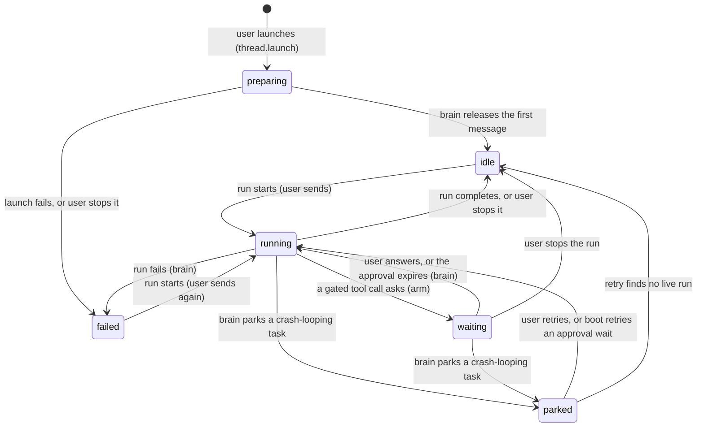
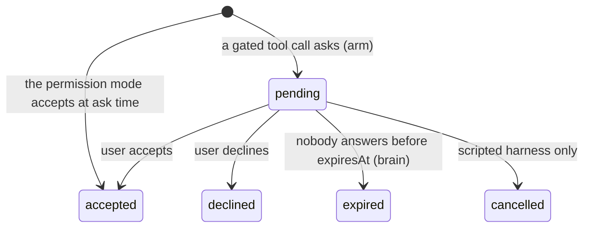
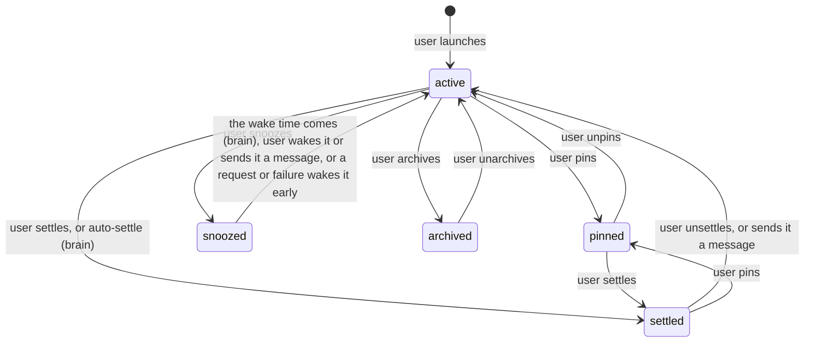

# Thread states

The one reference for every state a thread can be in, and the run, launch, approval, parked task and hold inside it: what the protocol says, what moves it, who may move it, what must stay true, and the words the UI shows for it.

The shape follows HumanLayer's `golden/session_state_machine.md` (humanlayer/humanlayer at `f16f286`, Apache-2.0): a status table with a category column, a transition diagram, transitions by actor with their handlers, numbered invariants and source references. The content is Cairn's own.

Source references are `path:first-last` at commit `8bb5d5b`. `judges/thread-states.test.ts` reads every literal union the protocol's schemas reach and fails when one of its values has no row in the status table or the label map below; a union that is not a state (a kind, a mode, an error reason) is named in the test's `NOT_STATUSES` with its reason.

## Categories

| Category | Means |
| --- | --- |
| Active | The brain or the arms are working on the thread now. |
| Waiting on you | Nothing moves until the user answers. |
| Held | A hold: the thread cannot move on by itself (a parked task, a Claude slot, a spent plan window). |
| Resting | Nothing runs and nothing is asked. |
| Failed | The latest run or launch failed; a send starts a new run. |
| Ended | An approval that no longer holds its tool call. |
| Shelf | Where the row sits in the sidebar, apart from what the thread is doing. |
| Ready, Off, Unknown | The state of something beside the thread (Executor, a provider) that threads depend on. |

## Statuses

The first column names the schema: the export that declares the union, or the export and field for a union declared inline. The first five are fields of the thread row (`ThreadShell`, `packages/protocol/src/Shell.ts:117-156`) that the shell stream carries; `ApprovalStatus` is the `status` of each record in a thread's `cairn.approvals` document, which the thread stream carries; the last two are read on the settings page.

| Schema | Value | Category | Meaning |
| --- | --- | --- | --- |
| `ThreadActivity` | `idle` | Resting | No run is live. The thread may have unseen work (`latestRunCompletedAt` after `lastVisitedAt`). |
| `ThreadActivity` | `preparing` | Active | A launch is under way: the row exists, the brain prepares the workspace and opens the conversation. No run yet. |
| `ThreadActivity` | `running` | Active | A run is live (`activeRunId` is set) and no approval is pending. |
| `ThreadActivity` | `waiting` | Waiting on you | A run is live and holds a tool call for an approval (`pendingRuntimeRequest` is set). |
| `ThreadActivity` | `parked` | Held | pi-durable parked at least one of the thread's tasks (`parkedTaskIds` is not empty). Wins over every other activity. |
| `ThreadActivity` | `failed` | Failed | The latest run failed, or the launch failed before its first run; `lastError` says why. |
| `RunFailureClass` | `usage_limit` | Held | The run was refused because a Claude plan window is spent; `usageLimitResetAt` says when it resets. |
| `RunFailureClass` | `provider_error` | Failed | The model provider refused the request. |
| `RunFailureClass` | `transport_error` | Failed | The model provider could not be reached. |
| `RunFailureClass` | `unknown` | Failed | The run or launch failed for a reason the brain does not classify. |
| `WaitingFor` | `claude_slot` | Held | One of the thread's Claude conversations waits for a Claude slot. The run is live; the bridge is full. |
| `WaitingFor` | `none` | Resting | Nothing beyond the user holds the thread. |
| `SettledOverride` | `settled` | Shelf | The thread is settled, by hand or by auto-settle. It sits on the Settled shelf. |
| `SettledOverride` | `active` | Shelf | The user unsettled it (or pinned a settled thread). Auto-settle leaves it alone until the user sends it a message. |
| `RuntimeRequestKind` | `executor-call` | Waiting on you | The pending approval holds a call to an Executor tool. |
| `RuntimeRequestKind` | `tool-call` | Waiting on you | The pending approval holds a call to one of Cairn's own tools. |
| `RuntimeRequestKind` | `user-input` | Waiting on you | The agent asked the user a question. |
| `RuntimeRequestKind` | `sign-in` | Waiting on you | A tool needs the user to sign in before it can run. |
| `ApprovalStatus` | `pending` | Waiting on you | The approval holds its tool call until the user answers or it expires. |
| `ApprovalStatus` | `accepted` | Ended | The user accepted it (or the permission mode accepted it when asked); the tool call runs. |
| `ApprovalStatus` | `declined` | Ended | The user declined it; the tool call does not run. |
| `ApprovalStatus` | `expired` | Ended | Nobody answered before `expiresAt`; the tool call does not run. |
| `ApprovalStatus` | `cancelled` | Ended | Defined for an approval withdrawn without an answer. Only the scripted harness reports it today. |
| `ExecutorStatus.state` | `connected` | Ready | The brain's link to Executor works; Executor's tools are offered to every thread. |
| `ExecutorStatus.state` | `needs-sign-in` | Waiting on you | Executor refused Cairn's grant; the user must sign in again. |
| `ExecutorStatus.state` | `unreachable` | Failed | Executor did not answer. |
| `ExecutorStatus.state` | `disabled` | Off | The link refuses every call: Cairn holds no Executor grant, another brain holds it, or the link has not been checked yet; `detail` says which. |
| `ProviderStatus.state` | `ready` | Ready | The provider has a working credential. |
| `ProviderStatus.state` | `missing` | Off | The provider has no credential. |
| `ProviderStatus.state` | `refused` | Failed | The provider refused the credential. |
| `ProviderStatus.state` | `unknown` | Unknown | The brain could not tell. |

### States without a status value

Some states have no literal of their own; the row says them through other fields.

| State | How the row says it | Category |
| --- | --- | --- |
| Launch | `activity` is `preparing`. The launch's phase (`created`, `workspace`, `ensured`) lives only in the brain's `thread_launches` table (`apps/server/src/threads/LaunchStore.ts:10-18`), so a restart resumes it. | Active |
| Run | `activeRunId` is set. pi-durable shows it as `pi.live.run`; the brain's RunStarted and RunTerminal bracket it, and RunTerminal's outcome (`completed`, `interrupted`, `failed`) stays in the brain (`apps/server/src/brain/HarnessSeam.ts:187-191`). | Active |
| Queued input | `queueLength` is above 0: inputs admitted but not yet in the transcript. | Active |
| Pending approval | `pendingRuntimeRequest` names the oldest pending approval and its kind. | Waiting on you |
| Parked task | `parkedTaskIds` lists each parked task; the thread offers Retry for the first. | Held |
| Hold | Computed by the client from the row: a parked task, else a `usage_limit` failure (Limited), else `waitingFor` `claude_slot`. | Held |
| Unseen | `latestRunCompletedAt` is after `lastVisitedAt` (or the thread was never visited). | Resting |
| Pinned | `pinnedAt` is set. | Shelf |
| Snoozed | `snoozedUntil` is in the future and nothing woke the thread early (see invariant 12). | Shelf |
| Woke | A snooze ended, on time or early, after the user last looked. | Resting |
| Archived | `archivedAt` is set. The thread leaves the shell stream (`ThreadRemoved`). | Shelf |
| Deleted | Tombstoned in the shell store; it leaves the shell stream. | Shelf |

## Transitions

### Activity

### Approval

### Shelf

### Caused by the user

| From | To | Trigger | Handler | Source |
| --- | --- | --- | --- | --- |
| none | `preparing` | `thread.launch` | `ThreadLaunch.launch` commits `ThreadCreate` (row born `idle`) then `activity: preparing` | `apps/server/src/threads/ThreadLaunch.ts:834-1029`, `apps/server/src/shell/ShellCommands.ts:835-888` |
| `preparing` | `failed` | `thread.stop` while launching | `Threads.stop` calls `ThreadLaunch.cancel`, which marks the row failed with "Stopped before the thread started." | `apps/server/src/threads/Threads.ts:210-217`, `apps/server/src/threads/ThreadLaunch.ts:1079-1116` |
| `idle`, `failed` | `running` | `thread.send` | `Threads.send` submits the turn; the run's RunStarted reaches the shell projector | `apps/server/src/threads/Threads.ts:183-208`, `apps/server/src/shell/ShellProjector.ts:238-254` |
| `running`, `waiting` | `idle` | `thread.stop` | `PiDurableHarness.stop` aborts the run; RunTerminal `interrupted` clears `activeRunId` | `apps/server/src/brain/PiDurableHarness.ts:461-504`, `apps/server/src/shell/ShellProjector.ts:255-270` |
| `waiting` | `running` | `thread.respond` | `PiDurableHarness.respond` writes the answer with `answerApproval`; the record leaves `pending` and the projector drops it | `apps/server/src/brain/PiDurableHarness.ts:535-560`, `apps/server/src/brain/CairnDocs.ts:381-408`, `apps/server/src/shell/ShellProjector.ts:290-305` |
| approval `pending` | `accepted`, `declined` | `thread.respond` | `answerApproval`; a record no longer `pending` answers `already_settled` | `apps/server/src/brain/CairnDocs.ts:381-408` |
| `parked` | `running` or `idle` | `thread.retryTask` (Retry) | `PiDurableHarness.retry` runs the task again and forgets it; `ShellProjector.refresh` recomputes the row from `inspect()` | `apps/server/src/rpc/ThreadStreamHandlers.ts:150-161`, `apps/server/src/brain/PiDurableHarness.ts:1024-1050`, `apps/server/src/shell/ShellProjector.ts:1040-1050` |
| shelf | settled | Settle | `ThreadSettle`, refused while busy, waiting or queued (`settleBlocker`); clears pin and snooze | `apps/server/src/shell/ShellCommands.ts:507-571`, `apps/server/src/shell/ShellCommands.ts:898-906` |
| settled | active | Unsettle | `ThreadUnsettle` sets `settledOverride: active` | `apps/server/src/shell/ShellCommands.ts:908-929` |
| settled or unsettled by hand, snoozed | active, under auto-settle again | `thread.send` | `Threads.send` commits `ThreadMessageSent` after the turn is admitted, when the row has a manual settle state or a snooze; it clears `settledOverride` and `settledAt` (stamping `unsettledAt` unless the user had unsettled it) and ends the snooze, as t3code's `dispatchMessage` does | `apps/server/src/threads/Threads.ts` (`recordMessageSent`), `apps/server/src/shell/ShellCommands.ts` (`messageSent`); added after `8bb5d5b` |
| shelf | snoozed | Snooze | `ThreadSnooze`, refused while an approval is pending or an input is queued | `apps/server/src/shell/ShellCommands.ts:931-970` |
| snoozed | active | Wake now | `ThreadUnsnooze` | `apps/server/src/shell/ShellCommands.ts:972-975` |
| shelf | pinned | Pin | `ThreadPin` clears settle and snooze | `apps/server/src/shell/ShellCommands.ts:977-1005` |
| pinned | active | Unpin | `ThreadUnpin` | `apps/server/src/shell/ShellCommands.ts:1007-1019` |
| any | archived, active | Archive, unarchive | `ThreadArchive`, `ThreadUnarchive` | `apps/server/src/shell/ShellCommands.ts:1076-1102` |
| any | deleted | Delete | `ThreadDelete` | `apps/server/src/shell/ShellCommands.ts:1104-1113` |

### Caused by the brain

| From | To | Trigger | Handler | Source |
| --- | --- | --- | --- | --- |
| `preparing` | `idle` | The workspace is ready and the conversation exists | The launch fiber commits `activity: idle` (the release) just before it submits the first message | `apps/server/src/threads/ThreadLaunch.ts:693-702` |
| `preparing` | `failed` | A launch step fails, or the project was removed first | `markFailed` writes `lastError` and `lastErrorClass: unknown`; after `ensured` a `cairn.notice` says why in the transcript | `apps/server/src/threads/ThreadLaunch.ts:261-279`, `apps/server/src/threads/ThreadLaunch.ts:613-621`, `apps/server/src/threads/ThreadLaunch.ts:740-808` |
| `preparing` | `idle`, then `running` | Boot finds a launch a restart cut off | `ThreadLaunch.resumePending` resumes it from its recorded phase, each phase idempotent | `apps/server/src/threads/ThreadLaunch.ts:1032-1056` |
| `running`, `waiting` | `idle` | The run completes | RunTerminal `completed` from the commit feed; `activityOf` recomputes | `apps/server/src/brain/CommitFeed.ts:209-252`, `apps/server/src/shell/ShellProjector.ts:154-175`, `apps/server/src/shell/ShellProjector.ts:255-270` |
| `running` | `failed` | The run fails | RunTerminal `failed` with the class from `classifyRunFailure`; `lastError` takes `FAILURE_TEXT` for the class | `apps/server/src/brain/RunFailure.ts:30-65`, `apps/server/src/shell/ShellProjector.ts:109-118`, `apps/server/src/shell/ShellProjector.ts:210-228` |
| any `lastErrorClass` | none | A run starts | RunStarted clears `lastError`, `lastErrorClass` and `usageLimitResetAt` | `apps/server/src/shell/ShellProjector.ts:238-254` |
| `waiting` | `running` | The approval expires | `awaitAnswer` times out and `expire` turns `pending` into `expired` | `apps/server/src/brain/CairnDocs.ts:251-264`, `apps/server/src/brain/CairnDocs.ts:308-337` |
| any | `parked` | pi-durable reports `task_parked` after five crashes in a row without progress | `Brain.report` adds it to `Parked`; the harness emits TaskParked; the projector adds the task id | `apps/server/src/brain/Brain.ts:148-154`, `apps/server/src/brain/PiDurableHarness.ts:905-919`, `apps/server/src/shell/ShellProjector.ts:307-312` |
| `parked` | `waiting` | Boot finds a parked task whose approval is still pending | `retryParkedApprovalWaits` retries it | `apps/server/src/Boot.ts:125-157` |
| `running`, `waiting` | `idle` | Boot finds no live run for a busy row | The boot reconcile ends the run it missed (`endedUnseen`) | `apps/server/src/shell/ShellProjector.ts:339-387` |
| `waitingFor` `none` | `claude_slot` and back | A Claude conversation of the thread waits for, then gets, a slot | `ClaudeSignals` sends the change; `applySignal` merges it; RunTerminal and the boot reconcile reset it to `none` | `apps/server/src/usage/ClaudeSignals.ts:60-91`, `apps/server/src/shell/ShellProjector.ts:317-331` |
| `usageLimitResetAt` none | set | A run failed with `usage_limit` | `ClaudeSignals` sends the latest reset of every spent plan window | `apps/server/src/usage/ClaudeSignals.ts:1-12` |
| shelf | settled | Quiet for `autoSettleDays` | `Settlement.sweep` every 5 minutes commits `ThreadAutoSettle`, refused if the row changed since the sweep read it | `apps/server/src/shell/Settlement.ts:139-158`, `apps/server/src/shell/Settlement.ts:238-288`, `apps/server/src/shell/ShellCommands.ts:1135-1145` |
| snoozed | active | The wake time comes | `Settlement.wakeSnoozed` commits `ThreadSnoozeExpire`, refused if the snooze changed | `apps/server/src/shell/Settlement.ts:290-314`, `apps/server/src/shell/ShellCommands.ts:1147-1158` |

### Caused by an arm

| From | To | Trigger | Handler | Source |
| --- | --- | --- | --- | --- |
| `running` | `waiting` | A tool call the permission mode gates (a Cairn tool, an Executor tool, a question, a sign-in) | The approval ledger's `ask` writes a `pending` record; the commit feed emits RuntimeRequestUpdated; the projector sets `pendingRuntimeRequest` | `apps/server/src/brain/CairnDocs.ts:222-249`, `apps/server/src/brain/CommitFeed.ts:373-402`, `apps/server/src/shell/ShellProjector.ts:290-305` |
| approval none | `accepted` | The same, when the permission mode accepts at ask time | `ask` writes the record `accepted` | `apps/server/src/brain/CairnDocs.ts:222-249` |

## Invariants

1. `activity` is a function of the other derived fields: `parked` when `parkedTaskIds` is not empty; else `waiting` or `running` while `activeRunId` is set, `waiting` exactly when `pendingRuntimeRequest` is also set; else what the newest run's end says; else a busy row becomes `idle` and `idle`, `preparing` or `failed` stays. The shell projector recomputes it on every change and never stores it apart from its inputs (`apps/server/src/shell/ShellProjector.ts:154-175`).
2. A row whose run is terminal has no `activeRunId`, has `latestRunCompletedAt` set, has `waitingFor` `none`, and its `activity` is `idle`, `failed` or `parked`. It is `failed` exactly when the run failed, and then `lastErrorClass` is set.
3. Only the launch writes `preparing`, and only before the thread's first run. A launched row is created `idle` and marked `preparing` in the next commit, so a client may see one `idle` frame between them (`apps/server/src/threads/ThreadLaunch.ts:943-1005`).
4. A launch ends in exactly one of: the release (`idle`, then the first run), `failed` with a `lastError`, or a stop (`failed` with "Stopped before the thread started."). A launch row in `thread_launches` exists only while its launch is unfinished.
5. `failed` lasts until the next run starts. Nothing but a new run (or a parked task) moves a thread out of `failed`, and RunStarted clears `lastError`, `lastErrorClass` and `usageLimitResetAt` together.
6. `lastErrorClass` is set exactly when `lastError` is set. A launch failure is always `unknown`; `usage_limit` comes only from the bridge's "Claude plan quota exceeded" text.
7. `pendingRuntimeRequest` names the oldest `pending` approval of the thread, and is none when the thread has none. After a restart, an approval the projector had not seen is shown as a `tool-call`, because `inspect()` carries only its id. An approval leaves `pending` once and never returns to it: `answerApproval` and `expire` change only a `pending` record.
8. A record is born `pending` or `accepted`; `declined`, `expired` and `cancelled` are reached only from `pending`.
9. `parkedTaskIds` changes only through pi-durable: a TaskParked event adds an id, and only a reconcile from `inspect()` (at boot, or the refresh after a retry) removes one.
10. Derived fields (activity, run times, queue, error, waiting, approval, preview, parked tasks) are written only by the shell projector and the launch (`preparing`, the release and `failed`); inbox fields (settle, snooze, pin, visit, archive) only by shell commands. A projector flush writes only the fields its events set, rebased on the row as it stands.
11. A thread cannot be settled while busy, waiting on an approval or holding a queued input, and cannot be snoozed while an approval is pending or an input is queued. Settling clears pin and snooze; pinning clears settle and snooze.
12. A snooze ends early, without a write, while an approval is pending or when a run failed after the snooze began; the client computes this (`effectiveSnoozed`, `packages/client-logic/src/ThreadSettled.ts:113-129`) and the settlement sweep uses the same rule (`isSnoozed`, `apps/server/src/shell/Settlement.ts:113-137`). The row keeps `snoozedUntil` until its time comes, the user changes it, or the user sends the thread a message.
13. `settledOverride` returns to none only when the user sends the thread a message. Auto-settle needs it to be none, so a thread the user settled, unsettled or pinned out of Settled is not auto-settled again until then. An auto-settled thread is `settled` like a manual one.
14. The shelf follows `settledOverride`, never `activity`: a settled thread the user sends a message to returns to the active shelf because the message clears the override, not because it runs.
15. An archived or deleted thread is not in the shell stream; its row is kept by the shell store.
16. Every status reaches the UI through a label (see the label map). No raw enum value is rendered as text; the sidebar row carries `activity` only as a `data-activity` attribute for tests.

## Label map

What the web client shows for each status today. The sidebar row's label comes from `resolveSidebarThreadStatus` and `resolveSidebarTopStatus` (`packages/client-logic/src/Sidebar.ts:178-242`) and its words from `TOP_STATUS_LOOKS` (`apps/web/src/sidebar/Row.ts:90-136`); the hold banner above an open thread from `holdOf` (`apps/web/src/shell/Parked.ts:139-260`).

| Schema | Value | The UI shows | Where |
| --- | --- | --- | --- |
| `ThreadActivity` | `idle` | No status label: the row's age, or "Done" when a run finished unseen, or "Woke" after a snooze ended unseen. | Sidebar row |
| `ThreadActivity` | `preparing` | "Working", with how long. | Sidebar row |
| `ThreadActivity` | `running` | "Working", with how long. | Sidebar row |
| `ThreadActivity` | `waiting` | "Approval" or "Input", from the pending request's kind. The row's "Waiting" label is never reached from `waiting`, because a pending request wins. | Sidebar row |
| `ThreadActivity` | `parked` | "Parked"; the banner says "Work on this thread stopped after it was cut off several times in a row." with "Retry" ("Retrying" while it runs). | Sidebar row, hold banner |
| `ThreadActivity` | `failed` | "Failed", or "Limited" for a `usage_limit` failure. The thread page shows `lastError` (`apps/web/src/View.ts:36-62`). | Sidebar row, thread page |
| `RunFailureClass` | `usage_limit` | "Limited"; the banner says "The Claude plan window is spent. It resets <day and time>." (or "Send again once it resets." with no reset time). | Sidebar row, hold banner |
| `RunFailureClass` | `provider_error` | "Failed", and `lastError`: "The model provider refused the request. Send again to retry." | Sidebar row, thread page |
| `RunFailureClass` | `transport_error` | "Failed", and `lastError`: "The model provider could not be reached. Send again to retry." | Sidebar row, thread page |
| `RunFailureClass` | `unknown` | "Failed", and `lastError`: "The run failed. Send again to retry.", or a launch's own message. | Sidebar row, thread page |
| `WaitingFor` | `claude_slot` | Banner "Waiting": "This thread is waiting for a Claude slot." The sidebar row keeps "Working". | Hold banner |
| `WaitingFor` | `none` | Nothing. | None |
| `SettledOverride` | `settled` | The row sits under the "Settled" shelf header ("Settled (<n>)" when folded); its menu offers "Unsettle". The undo notice after settling says "Settled <n> thread" or "threads", with Undo. | Sidebar |
| `SettledOverride` | `active` | Nothing of its own: the row sits on the active or pinned shelf and its menu offers "Settle". | Sidebar |
| `RuntimeRequestKind` | `executor-call` | "Approval". | Sidebar row |
| `RuntimeRequestKind` | `tool-call` | "Approval". | Sidebar row |
| `RuntimeRequestKind` | `user-input` | "Input". | Sidebar row |
| `RuntimeRequestKind` | `sign-in` | "Input". | Sidebar row |
| `ApprovalStatus` | `pending` | Only through the thread's row ("Approval" or "Input"). There is no approval card yet. | Sidebar row |
| `ApprovalStatus` | `accepted` | Not shown. | None |
| `ApprovalStatus` | `declined` | Not shown. | None |
| `ApprovalStatus` | `expired` | Not shown. | None |
| `ApprovalStatus` | `cancelled` | Not shown. | None |
| `ExecutorStatus.state` | `connected` | "Connected". | Settings, Executor (`apps/web/src/settings/View.ts:778-783`) |
| `ExecutorStatus.state` | `needs-sign-in` | "Needs sign-in", with the sign-in button. | Settings, Executor |
| `ExecutorStatus.state` | `unreachable` | "Unreachable". | Settings, Executor |
| `ExecutorStatus.state` | `disabled` | "Off". | Settings, Executor |
| `ProviderStatus.state` | `ready` | "Ready". | Settings, providers (`apps/web/src/settings/View.ts:384-389`) |
| `ProviderStatus.state` | `missing` | "No credential". | Settings, providers |
| `ProviderStatus.state` | `refused` | "Refused". | Settings, providers |
| `ProviderStatus.state` | `unknown` | "Unknown". | Settings, providers |

No status is shown raw. Two gaps: approval records past `pending` are not shown anywhere, because approval cards have not landed (full access, the default permission mode, asks for none); and the sidebar's "Waiting" label (`apps/web/src/sidebar/Row.ts:96-100`) has no path to it, since the projector sets `waiting` only together with a pending request, which the sidebar shows as "Approval" or "Input" first.

## Source references

- Protocol: `packages/protocol/src/Shell.ts:61-110` (`ThreadActivity`, `RunFailureClass`, `WaitingFor`, `PendingRuntimeRequest`, `SettledOverride`), `packages/protocol/src/Shell.ts:117-156` (`ThreadShell`), `packages/protocol/src/Policy.ts:46-65` (`RuntimeRequestKind`, `ApprovalStatus`), `packages/protocol/src/Executor.ts:7-18`, `packages/protocol/src/Models.ts:62-69`.
- Shell projector: `apps/server/src/shell/ShellProjector.ts:154-387`.
- Shell commands: `apps/server/src/shell/ShellCommands.ts:496-571`, `apps/server/src/shell/ShellCommands.ts:835-1158`.
- Settlement: `apps/server/src/shell/Settlement.ts:75-158`.
- Launch: `apps/server/src/threads/ThreadLaunch.ts`, `apps/server/src/threads/LaunchStore.ts:10-18`.
- Approval ledger: `apps/server/src/brain/CairnDocs.ts:202-408`.
- Parked tasks: `apps/server/src/brain/Parked.ts`, `apps/server/src/Boot.ts:125-157`.
- Client presentation: `packages/client-logic/src/PresentThreadShell.ts:77-121`, `packages/client-logic/src/Sidebar.ts:178-285`, `packages/client-logic/src/ThreadSettled.ts:54-129`.
- Words: `apps/web/src/sidebar/Row.ts:90-136`, `apps/web/src/shell/Parked.ts:139-260`, `apps/web/src/sidebar/View.ts:298-322`, `apps/web/src/settings/View.ts:384-389`, `apps/web/src/settings/View.ts:778-783`.
