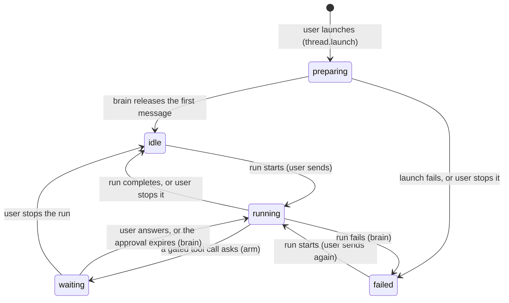
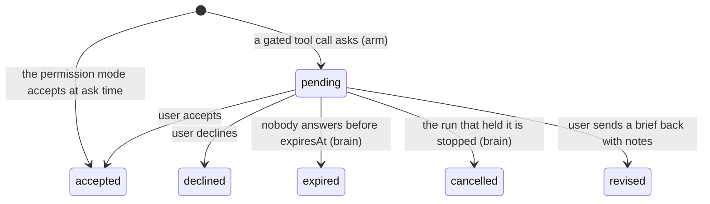
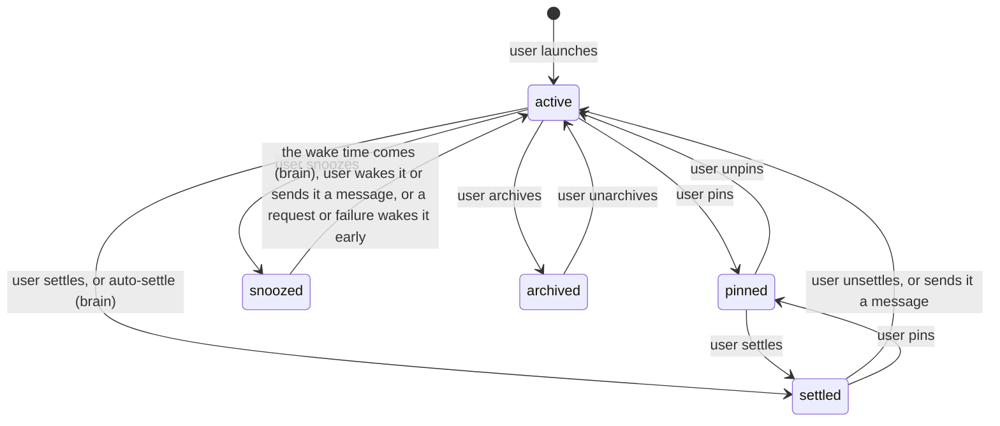

# Thread states

The one reference for every state a thread can be in, and the run, launch, approval and hold inside it: what the protocol says, what moves it, who may move it, what must stay true, and the words the UI shows for it.

The shape follows HumanLayer's `golden/session_state_machine.md` (humanlayer/humanlayer at `f16f286`, Apache-2.0): a status table with a category column, a transition diagram, transitions by actor with their handlers, numbered invariants and source references. The content is Cairn's own.

Source references name a path and the symbols in it, as `path` (`symbol`), never a line range, which rots unseen. `judges/thread-states.test.ts` reads every literal union the protocol's schemas reach and fails when one of its values has no row in the status table or the label map below; a union that is not a state (a kind, a mode, an error reason) is named in the test's `NOT_STATUSES` with its reason. It also fails when a cited path or symbol is gone, when a label map cell says "Not shown yet" for a union a client module reads, and when a cell does not quote the words the live label tables give (the settled-record lines, the budget and criterion words, the steps panel's node words, a settled child's label).

## Categories

| Category | Means |
| --- | --- |
| Active | The brain or the arms are working on the thread now. |
| Waiting on you | Nothing moves until the user answers. |
| Held | A hold: the thread cannot move on by itself (a Claude slot, a spent plan window). |
| Resting | Nothing runs and nothing is asked. |
| Failed | The latest run or launch failed; a send starts a new run. |
| Ended | Nothing more happens to it: a settled approval, a finished child, node or workflow. |
| Shelf | Where the row sits among the inbox shelves (active, pinned, snoozed, settled), apart from what the thread is doing. The brain keeps these fields and the client computes the shelf, but the sidebar draws no shelves (the user, 2026-10-29). |
| Ready, Off, Unknown | The state of something beside the thread (Executor, a provider) that threads depend on. |

## Statuses

The first column names the schema: the export that declares the union, or the export and field for a union declared inline. The first five are fields of the thread row (`ThreadShell`, `packages/protocol/src/Shell.ts`) that the shell stream carries; `ApprovalStatus` is the `status` of each record in a thread's `cairn.approvals` document, which the thread stream carries; `ExecutorStatus` and `ProviderStatus` are read on the settings page and `UsageReading` on the usage page. The rows after them are phase 2's (`docs/phase-2/plan.md`, step 1.0): a row's budget (`BudgetState`), a goal's criteria (`cairn.goal`), a parent's children (`cairn.subagents`, `cairn.escalations`), a child's settlements, a thread's workflows and their nodes (`cairn.workflows`), and portals (`reach.list`).

| Schema | Value | Category | Meaning |
| --- | --- | --- | --- |
| `ThreadActivity` | `idle` | Resting | No run is live. The thread may have unseen work (`latestRunCompletedAt` after `lastVisitedAt`). |
| `ThreadActivity` | `preparing` | Active | A launch is under way: the row exists, the brain prepares the workspace and opens the conversation. No run yet. |
| `ThreadActivity` | `running` | Active | A run is live (`activeRunId` is set) and no approval is pending. |
| `ThreadActivity` | `waiting` | Waiting on you | A run is live and holds a tool call for an approval (`pendingRuntimeRequest` is set). |
| `ThreadActivity` | `failed` | Failed | The latest run failed, or the launch failed before its first run; `lastError` says why. |
| `RunFailureClass` | `usage_limit` | Held | The run was refused because a model plan's usage limit was reached (a Claude plan window, a Codex limit or OpenCode Go's; the failure's `plan` says which); `usageLimitResetAt` says when it resets. |
| `RunFailureClass` | `provider_error` | Failed | The model provider refused the request. |
| `RunFailureClass` | `transport_error` | Failed | The model provider could not be reached. |
| `RunFailureClass` | `brain_restart` | Failed | The brain restarted while the model was answering and no retry was left (pi-durable's `interrupted`), or crashes cut the run off too often (`restart_limit`). |
| `RunFailureClass` | `unknown` | Failed | The run or launch failed for a reason the brain does not classify. |
| `WaitingFor` | `claude_slot` | Held | One of the thread's Claude conversations waits for a Claude slot. The run is live; the bridge is full. |
| `WaitingFor` | `parent` | Held | A subagent asked its parent a question (`ask_parent`) and waits for the parent's model to answer or escalate it. The user is not asked yet (ADR 0027). |
| `WaitingFor` | `none` | Resting | Nothing beyond the user holds the thread. |
| `SettledOverride` | `settled` | Shelf | The thread is settled, by hand or by auto-settle. Its shelf is settled. |
| `SettledOverride` | `active` | Shelf | The user unsettled it (or pinned a settled thread). Auto-settle leaves it alone until the user sends it a message. |
| `RuntimeRequestKind` | `executor-call` | Waiting on you | The pending approval holds a call to an Executor tool. |
| `RuntimeRequestKind` | `tool-call` | Waiting on you | The pending approval holds a call to one of Cairn's own tools. |
| `RuntimeRequestKind` | `user-input` | Waiting on you | The agent asked the user a question. |
| `RuntimeRequestKind` | `sign-in` | Waiting on you | A tool needs the user to sign in before it can run. |
| `RuntimeRequestKind` | `brief` | Waiting on you | A brief waits for Go: a subagent's (ADR 0026), or a workflow's launch approval, whose envelope covers its nodes' briefs (ADR 0032). No run holds it; nothing delegated starts until it is answered, in every permission mode, and it expires after 7 days (ADR 0030). |
| `RuntimeRequestKind` | `criteria` | Waiting on you | A goal's model proposed criteria and their judges; they bind only when the user accepts. |
| `ApprovalStatus` | `pending` | Waiting on you | The approval holds its tool call until the user answers or it expires. |
| `ApprovalStatus` | `accepted` | Ended | Accepted; the tool call runs, the brief's child starts, or the question returns its answer. `decidedBy` names who: the user, the permission mode at ask time, a parent's model (a question), or a workflow's envelope (a node's brief). |
| `ApprovalStatus` | `declined` | Ended | The user declined it; the tool call does not run. |
| `ApprovalStatus` | `expired` | Ended | Nobody answered before `expiresAt`; the tool call does not run. |
| `ApprovalStatus` | `cancelled` | Ended | Withdrawn without an answer: the stop of the run that held it (`decidedBy` system, `run-stopped`). Briefs and escalated questions, which no run holds, are not cancelled by a stop. Phase 1 brains left such records `pending`; both harnesses write `cancelled` since package 1A (conformance `approval_cancelled_on_stop`). |
| `ApprovalStatus` | `revised` | Ended | Sent back: the user answered a brief with notes (`reason`), and the proposer writes a new brief that `supersedes` it. Briefs only. |
| `ExecutorStatus.state` | `connected` | Ready | The brain's link to Executor works; Executor's tools are offered to every thread. |
| `ExecutorStatus.state` | `needs-sign-in` | Waiting on you | Executor refused Cairn's grant; the user must sign in again. |
| `ExecutorStatus.state` | `unreachable` | Failed | Executor did not answer. |
| `ExecutorStatus.state` | `disabled` | Off | The link refuses every call: Cairn holds no Executor grant, another brain holds it, or the link has not been checked yet; `detail` says which. |
| `ProviderStatus.state` | `ready` | Ready | The provider has a working credential. |
| `ProviderStatus.state` | `missing` | Off | The provider has no credential. |
| `ProviderStatus.state` | `refused` | Failed | The provider refused the credential. |
| `ProviderStatus.state` | `unknown` | Unknown | The brain could not tell. |
| `UsageReading` | `read` | Ready | The provider's plan windows were read; `windows` is what it reported. |
| `UsageReading` | `unreadable` | Unknown | The probe failed or the response changed shape. The meter says unknown, never zero (ADR 0037). |
| `UsageReading` | `unsupported` | Off | The provider has no readable windows (OpenCode Go). |
| `BudgetState` | `none` | Off | No budget covers the thread. |
| `BudgetState` | `within` | Ready | A budget covers the thread and its spend is under the warning line. |
| `BudgetState` | `warned` | Ready | Spend passed the warning line (`warnAt`, 0.8 by default); a notice went out once. |
| `BudgetState` | `exhausted` | Held | Spend reached the budget: a workflow aborts its running nodes, a goal's subagents take no new work, and a raise is an approval (ADR 0036). |
| `CriterionState` | `open` | Active | Not met yet: no `ok` verdict recorded since the criterion last changed. |
| `CriterionState` | `met` | Ended | The latest verdict, recorded by a judge run after the criterion last changed, is `ok`. Only the verdict writer sets it. |
| `CriterionState` | `failed` | Failed | The latest verdict is not `ok`. |
| `SubagentStatus` | `working` | Active | The child runs, or has an input queued. |
| `SubagentStatus` | `waiting` | Waiting on you | The child asked a question (of its parent or the user) or holds an approval. |
| `SubagentStatus` | `settled` | Ended | The child's latest input has a settlement; more inputs can still reach it. |
| `SubagentQuestionState` | `pending` | Held | The parent's model has the child's question and has not answered or escalated it. |
| `SubagentQuestionState` | `answered` | Ended | Answered, by the parent's model or by the user. |
| `SubagentQuestionState` | `escalated` | Waiting on you | Escalated to the user, shown in the parent thread (ADR 0027). |
| `SubagentQuestionState` | `cancelled` | Ended | Ended unanswered: the child's run that asked it was stopped (ADR 0029), or its record expired. |
| `EscalationStatus` | `open` | Waiting on you | A child's escalated question waits for the user in the parent thread. |
| `EscalationStatus` | `resolved` | Ended | Answered once, from either thread. |
| `SettlementOutcome` | `completed` | Ended | The child answered its input; the note carries its summary, divergence and payload. |
| `SettlementOutcome` | `stopped` | Ended | The child's run was stopped; the note says so and the parent is not woken if the user stopped the parent. |
| `SettlementOutcome` | `failed` | Failed | The child's run failed, or its result was invalid three times; `error` says why. A spent plan window (`usageLimit`) wakes nobody. |
| `WorkflowState` | `proposed` | Waiting on you | The launch approval waits for Go, Run on 1 first, or Decline. |
| `WorkflowState` | `approved` | Resting | Go was given; nothing runs until the model calls `codemode` with the same script, in the run that proposed it. |
| `WorkflowState` | `running` | Active | The script runs inside the launching thread's run. |
| `WorkflowState` | `finished` | Ended | The script returned; `outcome` says complete or partial, and why. |
| `WorkflowState` | `failed` | Failed | The script threw, or its replay diverged. |
| `WorkflowState` | `stopped` | Ended | The whole workflow was stopped; settled results stay. |
| `WorkflowState` | `declined` | Ended | The launch approval was declined, or Go was given and the run that proposed it ended first; nothing ran. |
| `NodeState` | `reserved` | Active | The ledger row is written; the child is not created yet. |
| `NodeState` | `running` | Active | The node's child runs. |
| `NodeState` | `held` | Held | The child's run hit a spent plan window; the node waits for the reset and other providers' nodes go on. |
| `NodeState` | `settled` | Ended | The node's result is validated and its receipt recorded. |
| `NodeState` | `failed` | Failed | The child failed, or its result was invalid twice; the script sees `null`. |
| `NodeState` | `stopped` | Ended | Stopped alone or with its workflow, or by a budget; the script sees `null`. |
| `NodeState` | `refused` | Ended | Refused before it started (`refusal` says why); the script sees `null`. |
| `NodeState` | `start_unknown` | Waiting on you | A stone or integrate node's start cannot be proved after a restart; the user is asked. Agent nodes never reach it. |
| `NodeState` | `stop_unknown` | Waiting on you | A stop of an outside job cannot be proved; the user is asked. |
| `PortalState` | `opening` | Active | The portal's row is written and its dev server is starting; it turns `open` when its port answers. |
| `PortalState` | `open` | Ready | The page answers at its URL. |
| `PortalState` | `stopped` | Off | The process ended (closed, expired, exited, or lost at boot); the name and command stay, so Start runs it again. |
| `PortalState` | `removed` | Ended | Closed for good; the name is free. |

### States without a status value

Some states have no literal of their own; the row says them through other fields.

| State | How the row says it | Category |
| --- | --- | --- |
| Launch | `activity` is `preparing`. The launch's phase (`created`, `workspace`, `ensured`) lives only in the brain's `thread_launches` table (`apps/server/src/threads/LaunchStore.ts` (`LaunchPhase`)), so a restart resumes it. | Active |
| Run | `activeRunId` is set. pi-durable shows it as `pi.live.run`; the brain's RunStarted and RunTerminal bracket it, and RunTerminal's outcome (`completed`, `interrupted`, `failed`) stays in the brain (`apps/server/src/brain/HarnessSeam.ts` (`RunTerminal`)). | Active |
| Queued input | `queueLength` is above 0: inputs admitted but not yet in the transcript. | Active |
| Pending approval | `pendingRuntimeRequest` names the oldest pending request the user can answer and its kind; `origin` names the child when it mirrors a child's escalated question. `pendingCount` counts them. | Waiting on you |
| Subagent | `lineage` is set: the row is a child. The sidebar lists it under its project thread among the threads that thread manages; the shelf partition (`partitionSidebarThreads`) leaves it out and resolves it to its nearest ancestor with a row. | Shelf |
| Children working | `subagents` counts the thread's children by `working`, `asking`, `settled` and `failed`; a thread whose run ended while children still work or ask says "Waiting". | Active |
| Goal | `goal` is set: the thread has criteria, counted `total`, `met` and `failed`. | Active |
| Hold | Computed by the client from the row: a `usage_limit` failure (Limited), else `waitingFor` `claude_slot`. | Held |
| Unseen | `latestRunCompletedAt` is after `lastVisitedAt` (or the thread was never visited). | Resting |
| Pinned | `pinnedAt` is set. | Shelf |
| Snoozed | `snoozedUntil` is in the future and nothing woke the thread early (see invariant 12). | Shelf |
| Woke | A snooze ended, on time or early, after the user last looked. | Resting |
| Archived | `archivedAt` is set. The thread leaves the shell stream (`ThreadRemoved`). | Shelf |
| Deleted | Tombstoned in the shell store; it leaves the shell stream. | Shelf |

## Transitions

### Activity

### Approval

### Shelf

### Caused by the user

| From | To | Trigger | Handler | Source |
| --- | --- | --- | --- | --- |
| none | `preparing` | `thread.launch` | `ThreadLaunch.launch` commits `ThreadCreate` (row born `idle`) then `activity: preparing` | `apps/server/src/threads/ThreadLaunch.ts` (`launch`), `apps/server/src/shell/ShellCommands.ts` (`ThreadCreate`) |
| `preparing` | `failed` | `thread.stop` while launching | `Threads.stop` calls `ThreadLaunch.cancel`, which marks the row failed with "Stopped before the thread started." | `apps/server/src/threads/Threads.ts` (`stop`), `apps/server/src/threads/ThreadLaunch.ts` (`cancel`) |
| `idle`, `failed` | `running` | `thread.send` | `Threads.send` submits the turn; the run's RunStarted reaches the shell projector | `apps/server/src/threads/Threads.ts` (`send`), `apps/server/src/shell/ShellProjector.ts` (`RunStarted`) |
| `running`, `waiting` | `idle` | `thread.stop` | `PiDurableHarness.stop` aborts the run; RunTerminal `interrupted` clears `activeRunId`; then `cancelStoppedApprovals` waits for the run's tasks to end and cancels the records they held | `apps/server/src/brain/PiDurableHarness.ts` (`stop`), `apps/server/src/brain/CairnDocs.ts` (`cancelStoppedApprovals`), `apps/server/src/shell/ShellProjector.ts` (`RunTerminal`) |
| `waiting` | `running` | `thread.respond` | `PiDurableHarness.respond` writes the answer with `answerApproval` (`decidedBy` user, the user's `reason`); the record leaves `pending` and the projector drops it | `apps/server/src/brain/PiDurableHarness.ts` (`respond`), `apps/server/src/brain/CairnDocs.ts` (`answerApproval`), `apps/server/src/shell/ShellProjector.ts` (`RuntimeRequestUpdated`) |
| approval `pending` | `accepted`, `declined` | `thread.respond` | `applyAnswer` writes status, `answer`, `decidedBy` and `reason` together; a record no longer `pending` answers `already_settled` | `apps/server/src/brain/CairnDocs.ts` (`applyAnswer`) |
| shelf | settled | Settle | `ThreadSettle`, refused while busy, waiting or queued (`settleBlocker`); clears pin and snooze | `apps/server/src/shell/ShellCommands.ts` (`settle`, `settleBlocker`, `ThreadSettle`) |
| settled | active | Unsettle | `ThreadUnsettle` sets `settledOverride: active` | `apps/server/src/shell/ShellCommands.ts` (`ThreadUnsettle`) |
| settled or unsettled by hand, snoozed | active, under auto-settle again | `thread.send` | `Threads.send` commits `ThreadMessageSent` after the turn is admitted, when the row has a manual settle state or a snooze; it clears `settledOverride` and `settledAt` (stamping `unsettledAt` unless the user had unsettled it) and ends the snooze, as t3code's `dispatchMessage` does | `apps/server/src/threads/Threads.ts` (`recordMessageSent`), `apps/server/src/shell/ShellCommands.ts` (`messageSent`) |
| shelf | snoozed | Snooze | `ThreadSnooze`, refused while an approval is pending or an input is queued | `apps/server/src/shell/ShellCommands.ts` (`ThreadSnooze`) |
| snoozed | active | Wake now | `ThreadUnsnooze` | `apps/server/src/shell/ShellCommands.ts` (`ThreadUnsnooze`) |
| shelf | pinned | Pin | `ThreadPin` clears settle and snooze | `apps/server/src/shell/ShellCommands.ts` (`ThreadPin`) |
| pinned | active | Unpin | `ThreadUnpin` | `apps/server/src/shell/ShellCommands.ts` (`ThreadUnpin`) |
| any | archived, active | Archive, unarchive | `ThreadArchive`, `ThreadUnarchive` | `apps/server/src/shell/ShellCommands.ts` (`ThreadArchive`, `ThreadUnarchive`) |
| any | deleted | Delete | `ThreadDelete` | `apps/server/src/shell/ShellCommands.ts` (`ThreadDelete`) |

### Caused by the brain

| From | To | Trigger | Handler | Source |
| --- | --- | --- | --- | --- |
| `preparing` | `idle` | The workspace is ready and the conversation exists | The launch fiber commits `activity: idle` (the release) just before it submits the first message | `apps/server/src/threads/ThreadLaunch.ts` (`prepare`) |
| `preparing` | `failed` | A launch step fails, or the project was removed first | `markFailed` writes `lastError` and `lastErrorClass: unknown`; after `ensured` a `cairn.notice` says why in the transcript | `apps/server/src/threads/ThreadLaunch.ts` (`markFailed`, `noteFailure`, `prepare`) |
| `preparing` | `idle`, then `running` | Boot finds a launch a restart cut off | `ThreadLaunch.resumePending` resumes it from its recorded phase, each phase idempotent | `apps/server/src/threads/ThreadLaunch.ts` (`resumePending`) |
| `running`, `waiting` | `idle` | The run completes | RunTerminal `completed` from the commit feed; `activityOf` recomputes | `apps/server/src/brain/CommitFeed.ts` (`runEnd`), `apps/server/src/shell/ShellProjector.ts` (`activityOf`, `RunTerminal`) |
| `running` | `failed` | The run fails | RunTerminal `failed` with the class from `classifyRunFailure`; `lastError` takes `FAILURE_TEXT` for the class | `apps/server/src/brain/RunFailure.ts` (`classifyRunFailure`), `apps/server/src/shell/ShellProjector.ts` (`FAILURE_TEXT`, `failureFields`) |
| any `lastErrorClass` | none | A run starts | RunStarted clears `lastError`, `lastErrorClass` and `usageLimitResetAt` | `apps/server/src/shell/ShellProjector.ts` (`RunStarted`) |
| `waiting` | `running` | The approval expires | `awaitAnswer` times out and `expire` turns `pending` into `expired` | `apps/server/src/brain/CairnDocs.ts` (`awaitAnswer`, `expire`) |
| `running`, `waiting` | `idle` | Boot finds no live run for a busy row | The boot reconcile ends the run it missed (`endedUnseen`) | `apps/server/src/shell/ShellProjector.ts` (`reconcileProjection`, `endedUnseen`) |
| `waitingFor` `none` | `claude_slot` and back | A Claude conversation of the thread waits for, then gets, a slot | `ClaudeSignals` sends the change; `applySignal` merges it; RunTerminal and the boot reconcile reset it to `none` | `apps/server/src/usage/ClaudeSignals.ts` (`applyWait`), `apps/server/src/shell/ShellProjector.ts` (`applySignal`) |
| `usageLimitResetAt` none | set | A run failed with `usage_limit` | `ClaudeSignals` sends the latest reset of every spent plan window | `apps/server/src/usage/ClaudeSignals.ts` |
| shelf | settled | Quiet for `autoSettleDays` | `Settlement.sweep` every 5 minutes commits `ThreadAutoSettle`, refused if the row changed since the sweep read it | `apps/server/src/shell/Settlement.ts` (`isAutoSettlementCandidate`, `sweep`), `apps/server/src/shell/ShellCommands.ts` (`ThreadAutoSettle`) |
| snoozed | active | The wake time comes | `Settlement.wakeSnoozed` commits `ThreadSnoozeExpire`, refused if the snooze changed | `apps/server/src/shell/Settlement.ts` (`wakeSnoozed`), `apps/server/src/shell/ShellCommands.ts` (`ThreadSnoozeExpire`) |

### Caused by an arm

| From | To | Trigger | Handler | Source |
| --- | --- | --- | --- | --- |
| `running` | `waiting` | A tool call the permission mode gates (a Cairn tool, an Executor tool, a question, a sign-in) | The approval ledger's `ask` writes a `pending` record; the commit feed emits RuntimeRequestUpdated; the projector sets `pendingRuntimeRequest` | `apps/server/src/brain/CairnDocs.ts` (`approvalLedger`), `apps/server/src/brain/CommitFeed.ts` (`documentEvents`), `apps/server/src/shell/ShellProjector.ts` (`RuntimeRequestUpdated`) |
| approval none | `accepted` | The same, when the permission mode accepts at ask time | `ask` writes the record `accepted` | `apps/server/src/brain/CairnDocs.ts` (`approvalLedger`) |

## Invariants

1. `activity` is a function of the other derived fields: `waiting` or `running` while `activeRunId` is set, `waiting` exactly when `pendingRuntimeRequest` is also set (a pending request with no run, such as a brief or an escalated question, leaves the row `idle`); else what the newest run's end says; else a busy row becomes `idle` and `idle`, `preparing` or `failed` stays. The shell projector recomputes it on every change and never stores it apart from its inputs (`apps/server/src/shell/ShellProjector.ts` (`activityOf`)).
2. A row whose run is terminal has no `activeRunId`, has `latestRunCompletedAt` set, has `waitingFor` `none`, and its `activity` is `idle` or `failed`. It is `failed` exactly when the run failed, and then `lastErrorClass` is set.
3. Only the launch writes `preparing`, and only before the thread's first run. A launched row is created `idle` and marked `preparing` in the next commit, so a client may see one `idle` frame between them (`apps/server/src/threads/ThreadLaunch.ts` (`launch`)).
4. A launch ends in exactly one of: the release (`idle`, then the first run), `failed` with a `lastError`, or a stop (`failed` with "Stopped before the thread started."). A launch row in `thread_launches` exists only while its launch is unfinished.
5. `failed` lasts until the next run starts. Nothing but a new run moves a thread out of `failed`, and RunStarted clears `lastError`, `lastErrorClass` and `usageLimitResetAt` together.
6. `lastErrorClass` is set exactly when `lastError` is set. A launch failure is always `unknown`; `usage_limit` comes only from the bridge's "Claude plan quota exceeded" text.
7. `pendingRuntimeRequest` names the oldest `pending` record of the thread that the user can answer, escalated children's questions included, and is none when the thread has none; a question routed to the parent is not one. After a restart, an approval the projector had not seen is named by its kind and asked time, which `inspect` reads from the thread's records. An approval leaves `pending` once and never returns to it: `answerApproval` and `expire` change only a `pending` record.
8. A record is born `pending` or `accepted`; `declined`, `expired`, `cancelled` and `revised` are reached only from `pending`, and every status past `pending` has `decidedBy` set. `payload` never changes after the ask (ADR 0029).
9. Crashes give a thread no state of its own (ADR 0046): pi-durable never ends a task for crashes, and boot's crash accounting aborts a task crashes cut off five times in a row unless it is a wait: a tool call that holds a record (an approval wait among them), a workflow's script call, `subagent_status`, a workflow's `agent` and `verify` calls, a call one of those is nested under, or a subagent or workflow wait task. A run it ends ends as a stopped one does; a tool call it ends gets an "aborted" result and the turn goes on. A run pi-durable ends for a crash itself (`interrupted`) fails with the class `brain_restart`. A row a 1.4 brain stored as `parked` reads `idle` (migration 0015) until the boot reconcile sets it.
10. Derived fields (activity, run times, queue, error, waiting, approval, preview) are written only by the shell projector and the launch (`preparing`, the release and `failed`); inbox fields (settle, snooze, pin, visit, archive) only by shell commands. A projector flush writes only the fields its events set, rebased on the row as it stands.
11. A thread cannot be settled while busy, waiting on an approval or holding a queued input, and cannot be snoozed while an approval is pending or an input is queued. Settling clears pin and snooze; pinning clears settle and snooze.
12. A snooze ends early, without a write, while an approval is pending or when a run failed after the snooze began; the client computes this (`packages/client-logic/src/ThreadSettled.ts` (`effectiveSnoozed`)) and the settlement sweep uses the same rule (`apps/server/src/shell/Settlement.ts` (`isSnoozed`)). The row keeps `snoozedUntil` until its time comes, the user changes it, or the user sends the thread a message.
13. `settledOverride` returns to none only when the user sends the thread a message. Auto-settle needs it to be none, so a thread the user settled, unsettled or pinned out of Settled is not auto-settled again until then. An auto-settled thread is `settled` like a manual one.
14. The shelf follows `settledOverride`, never `activity`: a settled thread the user sends a message to returns to the active shelf because the message clears the override, not because it runs.
15. An archived or deleted thread is not in the shell stream; its row is kept by the shell store.
16. Every status reaches the UI through a label (see the label map). No raw enum value is rendered as text, except a workflow node's status, which the steps panel shows as its own word ("queued", "done").

## Label map

What the web client shows for each status today. One function gives a thread's state, its category, its row label's words and tone, and its hold: `threadState` in `packages/client-logic/src/ThreadState.ts` (package 1E), with a descendant's request rolled up to its ancestors by `pendingSubagentRequests` (`packages/client-logic/src/SubagentRollup.ts`). The sidebar row (`apps/web/src/next/shell/Derived.ts` (`rowStatusOf`), drawn by `apps/web/src/next/shell/Sidebar.ts`) shows its status mark with the label's word as its title, and "Idle" or "Done" when the function gives no label; the hold banner above an open thread (`apps/web/src/next/shell/Hold.ts`) adds its sentences. The sidebar has no Active, Settled, Pinned or Snoozed groups (the user, 2026-10-29): the shelf is computed (`packages/client-logic/src/Sidebar.ts` (`sectionOf`)) but drawn nowhere. `judges/thread-state-rows.test.ts` checks every row of the status tables above against the function, and the words below against it.

| Schema | Value | The UI shows | Where |
| --- | --- | --- | --- |
| `ThreadActivity` | `idle` | No status label: "Done" when a run finished unseen, "Woke" after a snooze ended unseen, else the row's "Idle" or "Done" mark, beside its age. | Sidebar row |
| `ThreadActivity` | `preparing` | "Working", with how long. | Sidebar row |
| `ThreadActivity` | `running` | "Working", with how long. | Sidebar row |
| `ThreadActivity` | `waiting` | "Approval" or "Input", from the pending request's kind. The row's "Waiting" label is never reached from `waiting`, because a pending request wins. | Sidebar row |
| `ThreadActivity` | `failed` | "Failed", or "Limited" for a `usage_limit` failure. The thread page shows `lastError` (`apps/web/src/page/thread/LaunchFailure.ts` (`launchFailureOf`)). | Sidebar row, thread page |
| `RunFailureClass` | `usage_limit` | "Limited"; the banner says "The model plan's usage limit was reached. It resets <day and time>." (or "Send again once it resets." with no reset time). | Sidebar row, hold banner |
| `RunFailureClass` | `provider_error` | "Failed", and `lastError`: "The model provider refused the request. Send again to retry." | Sidebar row, thread page |
| `RunFailureClass` | `transport_error` | "Failed", and `lastError`: "The model provider could not be reached. Send again to retry." | Sidebar row, thread page |
| `RunFailureClass` | `brain_restart` | "Failed", and `lastError`: "The brain restarted while the model was answering. Send again to retry." | Sidebar row, thread page |
| `RunFailureClass` | `unknown` | "Failed", and `lastError`: "The run failed. Send again to retry.", or a launch's own message. | Sidebar row, thread page |
| `WaitingFor` | `claude_slot` | Banner "Waiting for a Claude slot": "This thread is waiting for a Claude slot." The sidebar row keeps "Working". | Hold banner |
| `WaitingFor` | `parent` | The child's managed row in the sidebar says "Asked its parent"; its ancestors are not lit and show no parent banner, since the user is not asked yet (6D). | Sidebar row |
| `WaitingFor` | `none` | Nothing. | None |
| `SettledOverride` | `settled` | Nothing: the sidebar draws no shelves and no page offers Settle or Unsettle; the brain still settles quiet threads and the row keeps the field. | None |
| `SettledOverride` | `active` | Nothing, as for `settled`. | None |
| `RuntimeRequestKind` | `executor-call` | "Approval". | Sidebar row |
| `RuntimeRequestKind` | `tool-call` | "Approval". | Sidebar row |
| `RuntimeRequestKind` | `user-input` | "Input". | Sidebar row |
| `RuntimeRequestKind` | `sign-in` | "Input". | Sidebar row |
| `RuntimeRequestKind` | `brief` | "Waiting for Go", in the approval colour. A child's brief shows the same words on its ancestors, below a descendant's approval and above its question. The brief card (6B) or a workflow's launch card (6F) asks it. | Sidebar row, request card |
| `RuntimeRequestKind` | `criteria` | "Approval". | Sidebar row |
| `ApprovalStatus` | `pending` | The request card asks it (6A), and the thread's row says "Approval" or "Input". | Request card, sidebar row |
| `ApprovalStatus` | `accepted` | The settled-record line in the transcript: "Approved by you", or by its decider and body ("Go from you", "Answered by you", "Accepted by full access"). | Transcript |
| `ApprovalStatus` | `declined` | The settled-record line: "Declined by you", or "Declined: <reason>" when the user gave one. | Transcript |
| `ApprovalStatus` | `expired` | The settled-record line: "Expired". | Transcript |
| `ApprovalStatus` | `cancelled` | The settled-record line: "Stopped", or "Cancelled at restart" when boot cancelled it. | Transcript |
| `ApprovalStatus` | `revised` | The settled-record line: "Sent back", with ": <reason>". | Transcript |
| `ExecutorStatus.state` | `connected` | "Connected". | Settings, Executor (`apps/web/src/next/settings/View.ts` (`EXECUTOR_STATUS`)) |
| `ExecutorStatus.state` | `needs-sign-in` | "Needs sign-in", with the sign-in button. | Settings, Executor |
| `ExecutorStatus.state` | `unreachable` | "Unreachable". | Settings, Executor |
| `ExecutorStatus.state` | `disabled` | "Off". | Settings, Executor |
| `ProviderStatus.state` | `ready` | "Ready". | Settings, providers (`apps/web/src/next/settings/View.ts` (`STATE_LABEL`)) |
| `ProviderStatus.state` | `missing` | "No credential". | Settings, providers |
| `ProviderStatus.state` | `refused` | "Refused". | Settings, providers |
| `ProviderStatus.state` | `unknown` | "Unknown". | Settings, providers |
| `UsageReading` | `read` | The plan's windows, or "Read, but it reported no windows." | Usage page (`apps/web/src/next/meters/UsageView.ts` (`planBody`)) |
| `UsageReading` | `unreadable` | "Unknown: the last reading failed or changed shape, so its windows are not shown." Never zero. | Usage page |
| `UsageReading` | `unsupported` | "This plan publishes no windows Cairn can read." | Usage page |
| `BudgetState` | `none` | Nothing: no budget line. | None |
| `BudgetState` | `within` | "Within budget" on the budget's card. | Usage page |
| `BudgetState` | `warned` | "Past its warning line" on the budget's card; a `cairn.notice` in the thread said so once, with a push. | Usage page, transcript |
| `BudgetState` | `exhausted` | "Budget reached: new work stopped" on the budget's card; a `cairn.notice` in the thread says where it stopped. | Usage page, transcript |
| `CriterionState` | `open` | "Open" beside the criterion; the goal chip counts it unmet ("2 of 4 met"). | Goal panel, goal chip |
| `CriterionState` | `met` | "Met" beside the criterion; the chip counts it. | Goal panel, goal chip |
| `CriterionState` | `failed` | "Not met" beside the criterion; the chip adds "1 not met". | Goal panel, goal chip |
| `SubagentStatus` | `working` | Counted in the parent's row (`subagents`): a parent whose run ended while a child works reads "Waiting". The child's own row, its subagent row and its work panel entry say what its run does. | Sidebar row, work panel |
| `SubagentStatus` | `waiting` | Counted as asking in the parent's row; the child's request lights the parent ("Approval" or "Input"). | Sidebar row, work panel |
| `SubagentStatus` | `settled` | Counted as settled in the parent's row; the child's entries read how its settlement ended (see `SettlementOutcome`). | Work panel, transcript |
| `SubagentQuestionState` | `pending` | Only through the child's row (see `WaitingFor` `parent`); the rollup and the parent banner leave it out (6D). | Sidebar row |
| `SubagentQuestionState` | `answered` | The child's record's settled-record line: "Answered by its parent thread", or "Answered by you" once escalated. | Transcript |
| `SubagentQuestionState` | `escalated` | The parent's request card asks it, with a link to the child that asked (6A, 6D); the child's own card asks it too, and either answer settles both. | Request card |
| `SubagentQuestionState` | `cancelled` | The child's record's settled-record line: "Stopped", or "Expired". | Transcript |
| `EscalationStatus` | `open` | The parent's request card for the mirrored question (6A, 6D). | Request card |
| `EscalationStatus` | `resolved` | The parent's mirror's settled-record line, as the answer was given ("Answered by you"). | Transcript |
| `SettlementOutcome` | `completed` | "Done" on the child's subagent row and work panel entry, with its result's summary. | Transcript, work panel |
| `SettlementOutcome` | `stopped` | "Stopped" on the child's subagent row and work panel entry. | Transcript, work panel |
| `SettlementOutcome` | `failed` | "Failed" on the child's subagent row and work panel entry, with its error. | Transcript, work panel |
| `WorkflowState` | `proposed` | No word of its own: the launch card asks Go, Run on 1 first or Decline (a `brief` record). | Request card |
| `WorkflowState` | `approved` | No word of its own: the steps panel offers Stop on the workflow. | Work panel |
| `WorkflowState` | `running` | No word of its own: its nodes say theirs, the headline tallies them ("4 nodes · 2 working · 1 done"), and Stop is offered on it and on each live node. | Work panel |
| `WorkflowState` | `finished` | No word of its own: a node still live under it reads "stopped", since the ledger never saw it finish. | Work panel |
| `WorkflowState` | `failed` | No word of its own: a node still live under it reads "failed". | Work panel |
| `WorkflowState` | `stopped` | No word of its own: a node still live under it reads "stopped". | Work panel |
| `WorkflowState` | `declined` | No word of its own: the launch card's settled-record line says "Declined by you", and a node under it would read "stopped". | Transcript, work panel |
| `NodeState` | `reserved` | "queued" in the steps panel (`apps/web/src/next/shell/WorkPanel.ts`), with Stop while its workflow runs. | Work panel |
| `NodeState` | `running` | "running", with Stop. | Work panel |
| `NodeState` | `held` | "held", with Stop. | Work panel |
| `NodeState` | `settled` | "done", with what it used and its result's summary. | Work panel |
| `NodeState` | `failed` | "failed", with its error. | Work panel |
| `NodeState` | `stopped` | "stopped". | Work panel |
| `NodeState` | `refused` | "refused", with why ("refused: the budget is spent"). | Work panel |
| `NodeState` | `start_unknown` | "unknown", with Stop. | Work panel |
| `NodeState` | `stop_unknown` | "unknown", with Stop. | Work panel |
| `PortalState` | `opening` | Not shown yet; the portal entry (6I). | None |
| `PortalState` | `open` | Not shown yet; the portal entry (6I). | None |
| `PortalState` | `stopped` | Not shown yet; the portal entry (6I), with Start. | None |
| `PortalState` | `removed` | Not shown yet; the portal entry (6I). | None |

No status is shown raw but a node's. Only portals (`PortalState`, 6I) are "Not shown yet", and the judge holds that cell to no client module reading them; the thread-state function (1E) is tested over every row of this document. A subagent's own request shows on every ancestor's row, approval over input, while the child's run is live (a brief or criteria whatever the run). The sidebar's "Waiting" label has one path: a thread whose run ended while its children still work or ask.

## Source references

- Protocol: `packages/protocol/src/Shell.ts` (`ThreadActivity`, `RunFailureClass`, `WaitingFor`, `PendingRuntimeRequest`, `SettledOverride`, `ThreadShell`), `packages/protocol/src/Policy.ts` (`RuntimeRequestKind`, `ApprovalStatus`, `CriterionState`), `packages/protocol/src/Executor.ts` (`ExecutorStatus`), `packages/protocol/src/Models.ts` (`ProviderStatus`), `packages/protocol/src/Subagents.ts` (`SubagentStatus`, `SettlementOutcome`), `packages/protocol/src/Workflows.ts` (`WorkflowState`, `NodeState`).
- Shell projector: `apps/server/src/shell/ShellProjector.ts` (`activityOf`, `reconcileProjection`).
- Shell commands: `apps/server/src/shell/ShellCommands.ts` (`isThreadBusy`, `settle`).
- Settlement: `apps/server/src/shell/Settlement.ts` (`threadHasQueuedTurnStart`, `isSnoozed`, `isAutoSettlementCandidate`).
- Launch: `apps/server/src/threads/ThreadLaunch.ts`, `apps/server/src/threads/LaunchStore.ts` (`LaunchPhase`).
- Approval ledger: `apps/server/src/brain/CairnDocs.ts` (`approvalLedger`).
- Crash accounting: `apps/server/src/brain/CrashLimit.ts`, `apps/server/src/BootRepairs.ts`.
- Client presentation: `packages/client-logic/src/ThreadState.ts` (`threadState`, `THREAD_LABELS`, `HOLD_LABELS`), `packages/client-logic/src/PresentThreadShell.ts` (`hasUnseenCompletion`), `packages/client-logic/src/Sidebar.ts` (`partitionSidebarThreads`, `sectionOf`), `packages/client-logic/src/ThreadSettled.ts` (`effectiveSnoozed`), `packages/client-logic/src/PendingRequests.ts` (`settledLineOf`), `packages/client-logic/src/ThreadLineage.ts` (`CHILD_LABELS`, `childStatusOf`), `packages/client-logic/src/WorkflowSteps.ts` (`workflowGroupsOf`, `workflowHeadline`), `packages/client-logic/src/Meters.ts` (`budgetWordOf`), `packages/client-logic/src/GoalProgress.ts` (`criterionStateLabel`).
- Words: `apps/web/src/next/shell/Derived.ts` (`rowStatusOf`), `apps/web/src/next/shell/Hold.ts`, `apps/web/src/next/shell/WorkPanel.ts`, `apps/web/src/next/settings/View.ts` (`STATE_LABEL`, `EXECUTOR_STATUS`), `apps/web/src/next/meters/UsageView.ts` (`planBody`).
